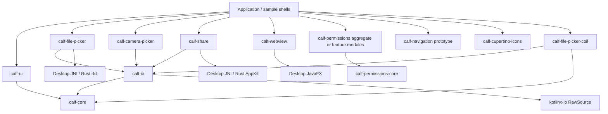

# Architecture and maintainer map

## Scope and how to use this knowledge base

This is a source-based map of upstream baseline
`af388bd3ad0325b2afdd8c0149cb7ff6f24c5da6`, imported into **nativeCmpkit**.
Identity-only migration edits are described separately in
[migration](../migration/README.md). Existing `calf-*` Gradle paths and
`com.mohamedrejeb.calf` public packages are compatibility boundaries, not a runtime
dependency on the old GitHub repository. Refer to an immutable source file with
`git show af388bd:<path>`; line numbers in audit findings refer to that baseline.

Read this overview, then [execution flows](execution-flows.md),
[dependencies](dependency-map.md), [source inventory](source-inventory.md), and the
[platform matrix](../platforms/README.md). The detailed module reports contain
function-by-function analysis, defects, tests and limitations:

| Responsibility | Detailed report |
|---|---|
| Adaptive controls, native managers, geometry, state, animation | [UI](../modules/ui.md) |
| Files, picker/saver, Rust dialogs, MIME mapping, Coil | [I/O and file picker](../modules/io-and-file-picker.md) |
| Permission registry, Android/iOS helpers, location prototype | [Permissions and geo](../modules/permissions-and-geo.md) |
| Camera, share, WebView, cookie stores, excluded prototypes | [Native features](../modules/native-features.md) |
| Core contexts, navigation, symbols/font, sample app | [Navigation/core/icons/sample](../modules/navigation-core-icons-sample.md) |

The inventory covers **607 tracked files**: 437 Kotlin, 38 Kotlin scripts, two
Rust and two Swift files, plus resources/configuration/documentation. Kotlin,
Kotlin scripts and Rust total **43,653 physical lines**; including Swift gives
43,708. Three explicitly generated Kotlin sources contribute 9,693 lines.
There are 15 test-source files, of which 13 contain 86 `@Test` annotations. These
are inventory counts, **not passing-test or semantic-review counts**.

## Product structure

nativeCmpkit is a collection of independently consumable KMP libraries, not a
single application framework. Most public APIs are Compose functions which
remember native adapters or mutable observable state. It does not own an
application-wide service container, navigation lifecycle, filesystem, permission
policy, or UI thread dispatcher. Host applications supply those environments.

Arrow direction means dependency, not callback direction. The complete
Gradle-declared `api`/`implementation` graph is in the inventory and dependency map.
Not every module depends on `calf-core`: WebView, permissions, navigation and geo
primarily consume Compose/OS APIs directly.

### Included libraries versus publishable libraries

`settings.gradle.kts:28-60` includes 24 library Gradle projects and five Gradle
sample projects. Permission projects are renamed at `settings.gradle.kts:63-74`
to retain artifact names (`:calf-permissions:core` becomes
`calf-permissions-core`, etc.). The directory paths remain nested.

| Module / family | Role and principal abstraction | Baseline publication plugin |
|---|---|---|
| `calf-core` | `PlatformContext`, composition local, experimental/internal opt-ins | Yes |
| `calf-io` | `KmpFile`, metadata/read helpers, `RawSource`, context-free overloads | Yes |
| `calf-file-picker` | File type/selection/settings models, remembered picker/saver, native bridge | Yes |
| `calf-file-picker-coil` | `KmpFileFetcher.Factory` and Coil-to-Calf context adapter | Yes |
| `calf-camera-picker` | Remembered capture launcher returning `KmpFile` | Yes |
| `calf-share` | `ShareContent`, `ShareResult`, remembered launcher | Yes |
| `calf-webview` | Content/state/navigation/settings/cookie API and embedded platform web engines | Yes |
| `calf-ui` | Adaptive controls; common state/rules plus Material/UIKit/Compose renderers | Yes |
| `calf-cupertino-icons` | Font codepoints and Compose icon rendering | Yes |
| `calf-permissions` | Compatibility umbrella re-exporting all permission subprojects | Yes |
| `calf-permissions/core` | Permission identity/status/state, registries, storage/SMS/call mappings | Yes |
| Ten permission features | Camera, gallery, location, background-location, Bluetooth, contacts, calendar, notifications, Wi-Fi, microphone | Yes, each |
| `calf-navigation` | In-memory adaptive route stack and a separate expect/actual controller API | **No** |
| `calf-geo` | Location models plus incomplete tracker implementations | **No** |
| `calf-maps` | Build file only; no implementation or public API | **No** |

This makes 21 projects applying `module.publication`. That is not proof of
successful publication or permission to publish. No nativeCmpkit release or
package is authorized by this audit. `calf-media` and `calf-notifications` exist
on disk but are **not included** in settings; the former has only stale build
configuration, the latter adds an unintegrated iOS experiment. They must not be
presented as supported features. Notification *permissions* are a different,
included submodule.

## Source-set architecture

`convention-plugins/src/main/kotlin/kotlin.multiplatform.gradle.kts` applies KMP
and the AGP KMP Android library plugin, then configures hierarchy/targets.
`compose.multiplatform.gradle.kts` adds Compose and its compiler. The shared
target list is Android, JVM named `desktop`, browser JS, browser WasmJS,
`iosArm64`, and `iosSimulatorArm64`.

| Source set with handwritten code | Targets consuming that code | Reason |
|---|---|---|
| `commonMain` | All declared library targets | Public contracts/models and shared algorithms |
| `materialMain` | Android, desktop, JS, WasmJS | Material3 actuals for adaptive controls |
| `nonAndroidMain` | Desktop, iOS, JS, WasmJS | Context sentinel, context adapters and shared non-Android helpers |
| `webMain` | JS and WasmJS | Browser File/DOM/iframe/share APIs; language-specific bridges remain below |
| `iosMain` | Arm64 device and Arm64 simulator | UIKit, Photos, Foundation, CoreLocation and other Objective-C APIs |
| `androidMain` | Android | Context/URI, ActivityResult, native views and permissions |
| `desktopMain` | Desktop JVM | Swing/AWT/JavaFX, local files, JNI bridges |
| `jsMain`, `wasmJsMain` | Corresponding browser target | Different JS interop representations, Promise/typed-array/eval adapters |

`Hirearchy.kt` deliberately creates overlapping groups. In particular Android's
new AGP target must be matched by `KotlinMultiplatformAndroidLibraryTarget`, not
KGP's old `KotlinAndroidTarget`, or Material actuals disappear from Android.
Do not flatten these groups while renaming packages. Default Kotlin hierarchy
groups may also exist without any tracked sources; the table is not a dump of
Gradle's evaluated dependency graph.

`iosX64` was deliberately removed in upstream PR #515. There is no active
Linux/Windows/macOS Kotlin/Native target and no Node.js target; “Desktop” means
JVM plus host-specific libraries. A file ending `.desktop.kt` is not evidence
it works on every desktop architecture. See the platform matrix for no-ops and
host restrictions.

## Boundary design and consequences

1. **Compose owns remembered objects; the OS owns presentation.** A launcher or
   manager typically lives in `remember`; `LaunchedEffect` pushes state into it;
   `DisposableEffect` is supposed to release views/delegates/observers. The native
   lifetime can outlast composition or a coroutine. Review disposal and late
   callbacks together, not as isolated functions.
2. **Common API shape is not common behavior.** Many UI functions accept Material
   content slots plus separate `ios*` descriptors. UIKit does not render arbitrary
   Compose slots inside a native alert/navigation bar. Some unsupported APIs
   compile and silently do nothing (camera on desktop/web, permissions there,
   geo tracking away from Android). Keep these limits explicit.
3. **Material3 types are part of public contracts.** Colors, `SelectableDates`,
   picker states and scroll behaviors bind the ABI to the selected Compose/
   Material versions. This is not an implementation-only dependency that can be
   updated without downstream compatibility checks.
4. **`PlatformContext` is intentionally thin.** Android actualizes it to
   `android.content.Context`; other targets use a singleton sentinel. It is not
   a storage abstraction or a UIKit controller. IO's `AndroidContextHolder`
   enables no-context file helpers only after initialization; the baseline file
   picker composable initializes it. There is no manifest provider initializer.
   Standalone IO/camera/share consumers should use explicit context overloads.
5. **`KmpFile` is an opaque platform handle, not a portable path.** It wraps Android
   `Uri`, JVM `File`, iOS readable/original `NSURL`, or browser `File`. Baseline
   `getPath()` may be a URI, and an iOS original URL may lose access. Opening
   `source()` is the intended stream boundary; browsers still buffer first.
6. **Native bridges have two compatibility surfaces.** Kotlin package/class names
   and Rust `Java_com_mohamedrejeb_...` exported symbols must agree. Resources
   contain host binaries selected by library name and OS/architecture directory.
   Changing only Maven group is not the same as changing these ABI names.
7. **Permissions are identities with lazy registration.** Accessing each
   `Permission.Companion.*` property initializes an object which registers an
   Android string mapping or iOS delegate factory. They are not an enum switch
   anymore. Including the umbrella pulls all feature references into the app;
   prefer narrow features when iOS privacy purpose strings matter.
8. **Navigation has no native screen lifecycle.** The working common host renders
   one route inside Compose. UIKit bars are overlaid onto a hosting controller,
   not managed by a UINavigationController per destination. Native iOS gesture
   transitions cannot be inferred from the `AdaptiveNavHost` name.

## Generated, vendored and handwritten boundaries

| Boundary | Evidence / maintenance rule |
|---|---|
| `calf-ui/.../sf/symbols/SFSymbol.kt` | Generated-marker file: 6,984 SF Symbol **name strings**, 7,006 lines; actual images are requested from UIKit. No generator is tracked. Do not mistake strings for redistributed Apple icon artwork. |
| `calf-cupertino-icons/.../CupertinoIcons.kt` | Generated-marker codepoint table: 1,322 constants, 1,335 lines; paired with the bundled font. |
| `sample/common/.../CupertinoIconsCatalogData.kt` | Generated-marker sample catalogue: 1,352 lines; not production behavior. |
| `calf-cupertino-icons/src/commonMain/composeResources/font/sf_symbols.ttf` | Binary font, misleading filename; provenance/license analysis is in the icons audit. It is separate from UIKit SF Symbol availability. |
| `calf-file-picker/.../jodd/net/MimeTypes.kt` and resources | Vendored MIME database/parser; not generated native bindings. Preserve attribution and review the parser as executable code. |
| `calf-file-picker/native/src/lib.rs`, `calf-share/native/src/lib.rs` | Handwritten unsafe JNI/native bridges, built by Cargo. No generated JNI wrapper validates the ABI for you. |
| `calf-webview/src/iosMain/cinterop/nskeyvalueobserving.def` | Handwritten 15-line Objective-C protocol embedded in a Kotlin/Native cinterop definition; compiler-generated stubs are build outputs. |
| `convention-plugins`, version catalog, Cargo manifests, workflows | Handwritten build logic/configuration. Gradle-generated resources/accessors, Kotlin native caches and downloaded binaries are not baseline source files. |

The removed upstream `external/backdrop` and `external/shapes` trees remain in
Git history but are not active source. Current iOS UI consumes published Kyant
libraries. This preserves the source lineage, not an offline copy of every
third-party dependency ever used.

## Application shells and extension points

`sample:common` composes the catalogue/application, uses local project
dependencies and configures the `Common` static iOS framework. Its framework
explicitly exports `calf-ui`; removing that export can affect Objective-C
target/action visibility. Android's `MainActivity`, desktop's AWT application,
browser `ComposeViewport` entrypoints, and `sample/ios/Calf.xcodeproj` host it.
The Xcode project is not a Gradle subproject. Demo screens exercise features but
are not automated regression tests or proof of native device compatibility.

For a new feature, first decide which owner manages callbacks/resources, which
targets genuinely implement it, and how “unavailable”, cancellation and errors
are reported. Add the public common contract, shared logic, platform actuals,
tests, capability documentation and consumer setup together. Keep no-op
implementations visibly unsupported until a compatible error/capability API is
designed. Do not add a new umbrella dependency merely to make a sample compile.

## Audit navigation

- [Audit overview](../audit/README.md), [historical review](../audit/historical-review.md)
- [Preserved upstream design history](../decisions/0002-upstream-design-history.md)
- [Testing evidence and unavailable environments](../testing/README.md)
- [Prioritized roadmap](../roadmap/README.md)

The audit is a baseline understanding, not a declaration of release readiness.
Confirmed defects, source-addressed historical reports and unverified platform
risks are deliberately kept separate.
