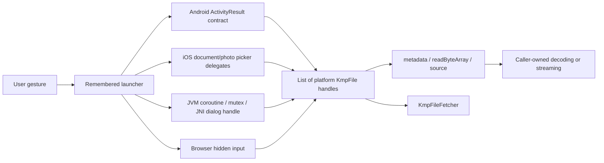

# Execution flows, ownership and change checkpoints

All flows describe baseline `af388bd`. “Intended ownership” below is not a claim
that cleanup is correct: the corresponding area findings document confirmed
gaps. Recomposition, coroutine cancellation, native callback delivery and OS
lifecycle transitions are independent events.

## 1. File selection → file handle → read/Coil

Common entrypoint:
`calf-file-picker/src/commonMain/kotlin/com.mohamedrejeb.calf/picker/FilePickerLauncher.kt`.
The caller provides type, single/multiple selection (with optional maximum),
settings and callback. A remembered launcher starts UI from a non-composable
event. Results are `List<KmpFile>`; an empty list can represent cancellation, but
baseline has no explicit error result that differentiates every failure.



| Platform | Selection flow and file identity | Critical ownership boundary |
|---|---|---|
| Android | `OpenDocument`, `OpenMultipleDocuments`, `OpenDocumentTree` or visual-media contracts; returned `Uri` becomes `KmpFile` | ActivityResult callback and activity recreation; grants belong to the provider/intent. A content URI is not a filesystem path. |
| iOS document | `UIDocumentPickerViewController` → delegate → security-scoped URL / copy staging → readable URL plus original URL | Provider access and original URLs can be temporary; copy lifetime/cleanup and directory special cases matter. |
| iOS photo | `PHPickerViewController` → each `NSItemProvider.loadFileRepresentation` callback → copy before provider expires → combine results | Callbacks may arrive off the main queue/out of order; a returned provider URL expires when its callback ends. Compatible image mode can transcode HEIC to JPEG. |
| Desktop | Remembered state/handle → JNI configuration setters → `rfd` native dialog → Java strings/files | Native `DialogConfig` is represented by a raw pointer in `Long`; it must not be freed while a suspended dialog/worker still uses it. |
| JS / WasmJS | Hidden `<input type=file>` configured with `accept`/`multiple` → browser `File` objects; Folder mode immediately returns an empty list | User activation, DOM removal, cancel delivery and callback lifetime are browser behavior, not normal JVM file semantics. |

Desktop loading uses `PlatformFilePicker`/`NativeLibLoader`/`NativeLibCache`,
optional parent-window handle extraction and handwritten Rust exports. Keep
native symbol names, resource basenames and host directories consistent. `rfd`
filter semantics differ from Android MIME types and iOS UTTypes; common file
type names must be traced to all three rather than assumed equivalent.

`calf-io` has two read paths:

- `readByteArray(context)` produces the full content in memory on every target.
  Its unsafe native copy implementations must enforce size/EOF bounds. Do not
  use this merely to discover size for a multi-gigabyte document.
- `source(context)` returns `kotlinx.io.RawSource`. Android wraps
  `ContentResolver.openInputStream`; JVM/iOS use `SystemFileSystem`. Opening is
  blocking despite `suspend`, and subsequent `RawSource` operations are
  synchronous. The caller chooses a suitable dispatcher and closes the source.
  Browser JS/Wasm first buffer the complete file, then expose a source over the
  bytes: same API, different memory complexity.

Context-free overloads use `resolveContext()`. Android relies on the application
context initialized by `rememberFilePickerLauncher` (not a manifest provider);
non-Android uses `PlatformContext`'s sentinel. No-context reads before that
initialization throw; explicit-context overloads remain available. They do not
discover a fresh activity or obtain additional storage
permissions. `KmpFileFetcher` is a small Coil adapter; it reads the bytes and
returns a Coil source rather than providing a zero-copy universal image path.
See the I/O report before changing cancellation, stream ownership or metadata.

**Regression checkpoints:** cancellation vs failure, recomposition while the
picker is open, owner disposal, simultaneous launches, process recreation,
empty/large/short-read sources, HEIC/live photos, provider expiration, unknown
MIME, folder and initial-directory behavior, callback dispatcher, JNI disposal
race, and two processes sharing cached native binaries.

## 2. Save/export and sharing are not equivalent operations

`FileSaverLauncher` accepts bytes or a `KmpFile` plus output filename; each
platform chooses a different transport:

- Android starts `CreateDocument`, then writes pending content to the chosen
  URI on the IO dispatcher. Pending data is part of the operation, not a local
  recomposition scratch variable; baseline currently violates that distinction.
- iOS stages data/files for a document export controller. Export mode (`copy`
  versus `move`), source ownership, staged filename, interactive dismissal and
  cleanup are observable API behavior. Open upstream PR #551 changes these but
  is not part of the audited baseline.
- Desktop obtains a path through `rfd`, then uses JVM file writes/copies. The
  filesystem operation can fail after a successful dialog result.
- Browser creates a Blob/object URL and programmatically clicks a download
  anchor. It cannot verify the user's eventual disk write; baseline also lacks
  a saver completion callback. A download request is not verified “saved”.

`ShareLauncher` accepts `ShareContent.Text`, `Url`, `File` or `Files` and returns
`Success`, `Dismissed` or `Unavailable`. Android dispatches intents; iOS uses
`UIActivityViewController`; macOS desktop uses JNI/AppKit sharing; Windows/Linux
copy/open content; browsers use Web Share when available and otherwise clipboard
fallbacks. These outcomes do not all establish recipient delivery. Failure of an
asynchronous clipboard write or file preparation must not be relabeled success.

Sharing a file needs a readable handle acceptable to the receiving application;
an Android private path is not automatically a shareable URI, an iOS transient
provider URL is not a durable file, and a browser `File` is not an OS path.
Temporary files, grants and completion handlers need an explicit owner per
operation. The native-features report traces each implementation separately.

## 3. Permission identities → registry → request → observable status

Entry functions live in `calf-permissions/core/.../PermissionState.kt` and
`MultiplePermissionsState.kt`. They first return inert granted preview objects
in Compose inspection mode; otherwise they call platform `rememberMutable*`
actuals. A public `Permission.Companion.Camera`-style extension initializes a
singleton which calls its platform `register*Permission` actual.

```text
feature property access
  -> Permission singleton initialization
  -> Android platform-string registry / iOS helper factory registry
  -> remembered MutablePermissionState
  -> initial status query + lifecycle refresh registration
  -> user calls launchPermissionRequest()
  -> platform request callback
  -> observable status + caller's Boolean callback
```

Android groups version-dependent manifest permissions, computes status/rationale,
and uses ActivityResult permission launchers. Multiple permissions flatten
logical permissions to OS strings and map results back. Shared platform strings
are an aliasing hazard; default/empty maps and pre-runtime-permission API levels
require deterministic completion behavior.

iOS delegates query/request AVFoundation, Photos, CoreLocation, Bluetooth,
Contacts, EventKit, UserNotifications or local-network services. iOS does not
offer Android's universal rationale semantics. Helpers map native authorization
states to `Granted` or `Denied(shouldShowRationale)`, and request gating uses that
mapping; a wrong mapping can make a valid upgrade impossible. Main-queue state
updates, retained Objective-C delegates and one request's completion callback
cannot be assumed independent when multiple states share a helper singleton.
Lifecycle resume must consider revocations as well as grants.

Desktop/JS/Wasm compile the common API but return `Denied(false)` and no-op
request/settings/refresh calls. A portable feature that waits for their callback
can never advance. The library does not implement contact reading, OTP parsing,
notification scheduling or Wi-Fi scanning just because those permission names
exist. Use the [permission report](../modules/permissions-and-geo.md) and do not
substitute automatically granted results without defining capability semantics.

**Regression checkpoints:** cold start, already granted/denied/restricted,
revocation in Settings, multiple observers, multiple logical permissions mapping
to one OS permission, upgrade foreground→background location, iOS limited/write-
only authorization, empty Android request set, process recreation and missing
purpose strings.

## 4. Adaptive UI → shared state → native or Material renderer

Common `expect` functions define the public UI API. `materialMain` forwards
largely to Material3 on Android/desktop/web. `iosMain` is a mixture:

- Native alerts, date/time controls, sheets, navigation bars, toolbars and
  menus/buttons use UIKit objects/managers/delegates.
- Cupertino circular progress and some controls are Compose drawing/layout, not
  a native view per widget.
- iOS glass styling combines OS-version-gated UIKit configuration with Compose
  backdrop/shader/shape work; “Liquid Glass” is not one uniform implementation.

### Calendar selection

`AdaptiveDatePickerState` owns selected date/display mode and an observable
Material3 `SelectableDates` rule. `DateBounds` uses UTC epoch-day normalization,
civil-date arithmetic and inclusive bounds; combined rules must reject invalid
selections consistently. The Material wrapper exposes the current rule object so
Material's cached enabled-day values can invalidate. iOS 16+ inline uses
`UICalendarView`; wheels/compact and older inline fallback use `UIDatePicker`,
which only expresses native min/max and must reconcile arbitrary rule rejections.
The range picker uses shared Material state on all targets, with an iOS 16+
native calendar range backend and a Material fallback on older iOS. “Date”
milliseconds are not arbitrary local wall
clock instants; preserve UTC-day versus local presentation behavior deliberately.

### Sheets and alerts

Common sheet state maps to Material or native sheet visibility/presentation.
iOS content is a Compose-hosting controller presented by UIKit. The composition
must receive the correct parent locals and survive interaction without unwanted
new controllers. An alert manager retains UIKit actions/targets/delegates;
updating properties during recomposition is separate from replacing actions and
callbacks. Recent strong-reference fixes do not automatically make every closure
fresh or every dismissal exactly once.

### Scaffold and native bars

`AdaptiveScaffold.ios.kt` still uses a Material `Scaffold`, but provides
`LocalIosTopBarPadding`, `LocalIosTabBarPadding` and a `LocalBackdrop`. Native
bars add subviews to `LocalUIViewController.current.view`; placeholder Compose
positions and measured native heights synchronize placement. The scaffold merges
native padding with Compose padding using `maxOf` and animation. This explains
why stale measurement after rotation (#548) and two screens overlapping during
navigation transitions (#530) can happen despite individually correct bars.
The overlay lifetime belongs to the host controller/composition, not a native
navigation-stack entry.

**Regression checkpoints:** callback replacement without recreating native UI,
dark/light/RTL/density changes, Dynamic Type/accessibility, tablet popover anchors,
rotation/window resizing/safe-area changes, transition overlap, interaction while
leaving composition, iOS availability, impossible date rules and large date ranges.

## 5. WebView state and command/event flow

Common `WebViewState` carries `WebContent` (`Url`, `Data`, `NavigatorOnly`),
loading/progress/title/last URL, settings, errors and cookie manager. A remembered
`WebViewNavigator` emits Back/Forward/Reload/Stop/LoadUrl/LoadHtml events through a
`MutableSharedFlow(replay = 1)`. Platform effects collect content and navigator
events independently; OS callbacks write state back to Compose. Replayed commands
and state restoration must be tested across teardown/recreation.

| Actual | Creation / navigation / observations |
|---|---|
| Android | Native WebView in Compose Android interop; settings, WebViewClient/WebChromeClient; back handling; page callbacks update state |
| iOS | WKWebView plus navigation delegate and handwritten KVO protocol bridge for estimated progress/title/URL; swipe gesture configured from `captureBackPresses` |
| Desktop | Remember `JFXPanel` on Swing/Compose side; create JavaFX `WebView`/Scene on FX queue; observe `loadWorker`, history and content; `SwingPanel` hosts it |
| JS/Wasm | DOM iframe via `CalfWebElementView` actual; same-origin access constrains document title, script evaluation, cookies and navigation |

Cookie APIs are not one shared jar. Android uses android.webkit's global store,
iOS a WKHTTPCookieStore, desktop a Java CookieManager/handler, web the current
document's cookie surface. URL/domain/path/HttpOnly/SameSite semantics and global
state side effects vary. Sensitive URL/script/cookie data must not be logged or
confused with trusted app-origin content.

Desktop's current `applySettings` uses `Platform.runLater` (`WebView.desktop.kt:
215-221`), so open upstream #344's old direct-EDT-setting crash is **source-
addressed**, not automatically still present. `JFXPanel()` initialization remains
in `remember` (`:50`); #346's nested AWT loop reentry needs current-host
reproduction. Neither source observation proves the entire desktop lifecycle is
safe. See native-features findings for observer, teardown, header/settings,
cross-origin and cookie limitations.

## 6. Navigation and samples

`AdaptiveNavHostController` owns an in-memory back stack and destination graph;
`AdaptiveNavHost` renders the current destination and wraps it in a
`SaveableStateHolder` keyed by **route string**. It retains state for routes still
on the stack and removes state once absent. A repeated route is not a distinct
entry identity, and ordinary `remember` does not persist the controller's entire
stack through host recreation. Arguments/bundles/types are custom code, not
delegated to AndroidX on every platform.

A separate `expect NavHostController` aliases AndroidX on Android and the
adaptive controller elsewhere. That does not turn the sample's explicitly
constructed adaptive host into an AndroidX navigation graph. Android back has an
actual handler; other platform handlers are no-ops. There is no native iOS
UINavigationController stack or browser-history synchronization in this module.
The module intentionally lacks a publication plugin.

`sample/common` demonstrates all these APIs and is hosted by platform entrypoints.
Networking engines and Coil configuration are application choices. Demo state,
hardcoded example URLs, preview screens and unused prototypes should not be
mistaken for a tested contract. Every bug reproduction must identify whether it
uses the adaptive navigator, JetBrains navigation or a consumer's navigation3
stack; their lifecycle behavior is not interchangeable.

## Cross-cutting maintenance checklist

For any native-facing change, write down (1) creation owner, (2) callback owner,
(3) executing thread/queue, (4) cancellation behavior, (5) disposal order,
(6) process/host recreation behavior, (7) unsupported-platform result and
(8) a repeatable regression test. A Kotlin `suspend` modifier does not move work
to IO, a Compose `remember` does not retain an Objective-C weak delegate for free,
and a nullable return alone cannot identify every cancel/error case. These are
the recurring fault boundaries across otherwise separate modules.
